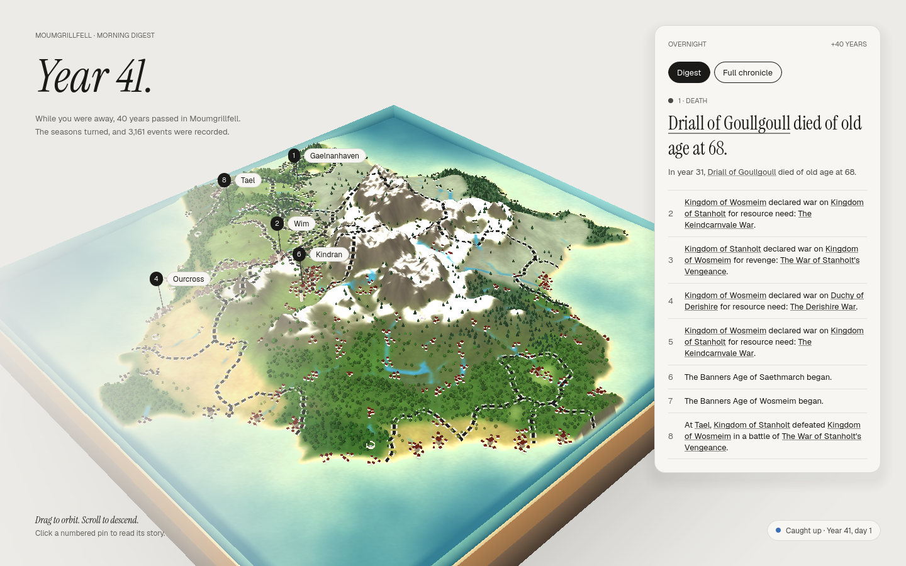
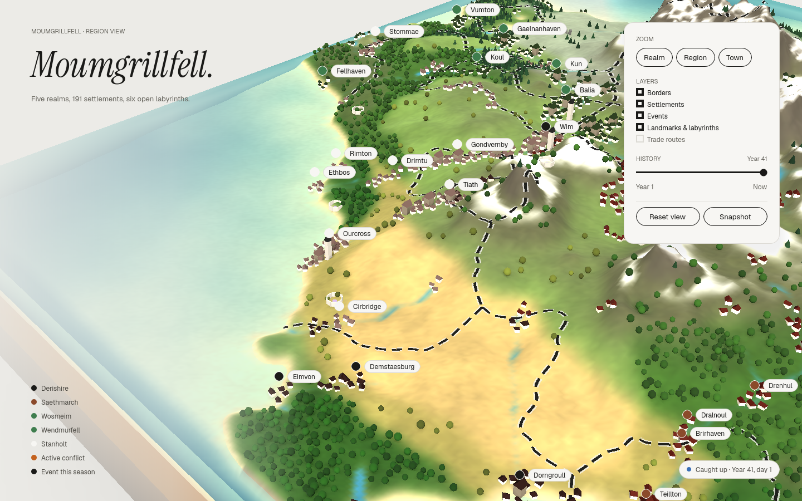
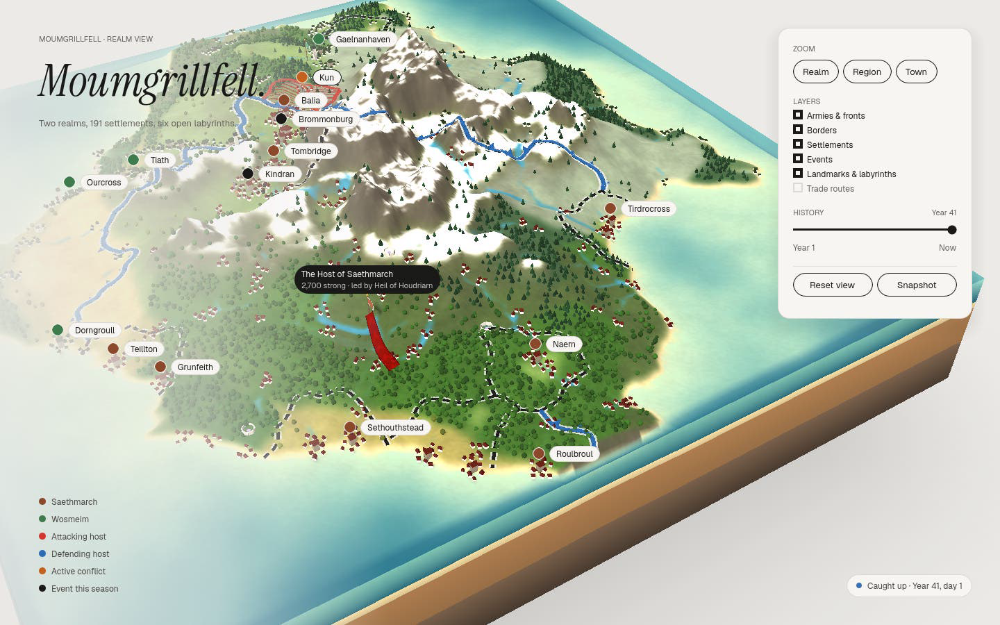
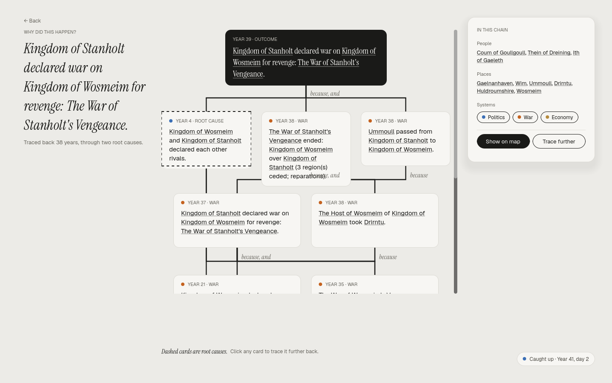

# Fantasy World

A persistent fantasy world simulation — the world keeps moving while you sleep.
1 real day = 1 world year. You are the chronicler: come back each morning to see who rose, who fell, and *why*.

## Layout

- `sim/` — headless .NET 8 simulation core, tests and the `fw` CLI
- `sim/FantasyWorld.Client/` — the game's engine-free logic (session, terrain, layout), tested with the rest
- `game/` — the Godot 4.3 diorama client
- `docs/superpowers/specs/` — design specs
- `docs/superpowers/plans/` — implementation plans

## The game



The world is a floating diorama: drag to orbit, scroll to descend from the whole realm to a single town. On launch
the world catches up on the time you were away and opens on the *morning digest*: the year, what changed, the
headline and *why did this happen?* Every name is a link: people open their life and ties, places fly the camera
there, realms and artifacts open their pages, and any event opens the chain of causes that led to it. The *map*
adds layers, a history slider back to Year 1, and a card for every settlement. While the game is open the world
lives on (one world day every four real minutes) and announces what matters.



War is drawn like a strategy map: each host's banner (in its realm's colours) marches from region to region along
a broad campaign arrow toward its target, attackers in red and defenders in blue; fronts carry teeth facing the
attacker, occupied land is hatched, and crossed swords mark this year's battles. Click a banner for its commander,
a battle for why it was fought. Knights ride with their realm's host, and battles can wound, kill or make them famous.




Run it with [Godot 4.3 .NET](https://godotengine.org/download/archive/4.3-stable/) and the .NET 8 SDK:

```bash
dotnet build game/FantasyWorld.Game.csproj
godot --path game                                   # first launch creates a world with a century of prehistory
godot --path game -- --world worlds/aerenmoor.fw.db # or open a world made with the CLI
```

Keys: **Esc** back · **H** home (the digest) · **M** the map. Worlds live in Godot's user folder unless given.

Checks: `godot --headless --path game res://tests/HeadlessChecks.tscn` drives every screen on a fresh world and
exits non-zero on failure (CI runs it). `godot --path game res://tests/Showcase.tscn -- --shots <dir>` renders a
full-size world from the angles above, and `godot --path game --write-movie war.avi --fixed-fps 30 res://tests/WarMovie.tscn`
films a host on the march (both need a display).

## Run

```bash
dotnet test sim
dotnet run --project sim/FantasyWorld.Cli -- new worlds/aerenmoor.fw.db            # medium world (100 regions)
dotnet run --project sim/FantasyWorld.Cli -- map worlds/aerenmoor.fw.db            # ASCII map (--layer regions)
dotnet run --project sim/FantasyWorld.Cli -- catchup worlds/aerenmoor.fw.db        # simulate real elapsed time
dotnet run --project sim/FantasyWorld.Cli -- advance worlds/aerenmoor.fw.db 50y    # debug fast-forward
dotnet run --project sim/FantasyWorld.Cli -- regions worlds/aerenmoor.fw.db
dotnet run --project sim/FantasyWorld.Cli -- region worlds/aerenmoor.fw.db 12
dotnet run --project sim/FantasyWorld.Cli -- why worlds/aerenmoor.fw.db <event-id>
dotnet run --project sim/FantasyWorld.Cli -- characters worlds/aerenmoor.fw.db       # living notables
dotnet run --project sim/FantasyWorld.Cli -- life worlds/aerenmoor.fw.db <char-id>    # a biography
dotnet run --project sim/FantasyWorld.Cli -- artifacts worlds/aerenmoor.fw.db
dotnet run --project sim/FantasyWorld.Cli -- artifact worlds/aerenmoor.fw.db <id>     # powers and provenance
dotnet run --project sim/FantasyWorld.Cli -- realms worlds/aerenmoor.fw.db           # kingdoms and their vassals
dotnet run --project sim/FantasyWorld.Cli -- realm worlds/aerenmoor.fw.db <id>        # laws, council, treaties, eras
dotnet run --project sim/FantasyWorld.Cli -- wars worlds/aerenmoor.fw.db
dotnet run --project sim/FantasyWorld.Cli -- war worlds/aerenmoor.fw.db <id>          # casus belli and the course of the war
dotnet run --project sim/FantasyWorld.Cli -- map worlds/aerenmoor.fw.db --layer realms
dotnet run --project sim/FantasyWorld.Cli -- tell worlds/aerenmoor.fw.db <event-id>    # the why-chain as prose
dotnet run --project sim/FantasyWorld.Cli -- stats worlds/aerenmoor.fw.db             # world summary and LLM spend
```

## Story beats from Claude

The world runs fully offline by default: rules make every choice and templates tell the story. To let Claude
decide notables' choices, arbitrate duels, hunts and delves, name forged artifacts, wars and eras, and narrate
with `fw tell`:

```bash
export ANTHROPIC_API_KEY=...        # never stored in the world file
dotnet run --project sim/FantasyWorld.Cli -- llm worlds/aerenmoor.fw.db --provider anthropic --cap 5
dotnet run --project sim/FantasyWorld.Cli -- advance worlds/aerenmoor.fw.db 2y
```

Defaults: `claude-opus-5-5` for every job (`--model narrate=<model>` changes one), 60 story beats and 200
narrations per rolling day, and a $10 cap per 30 days; past it, or without credentials, the rules take over.
`--provider openrouter` uses `OPENROUTER_API_KEY` instead. Every answer is journaled in the world file, so
reloading or replaying a world never asks again, and `fw why` shows the motives and accounts it gave.

`--size tiny` makes a 64×64 world with 12 regions for quick experiments (and no prehistory; medium and large
worlds start with 100 years of it, `--prehistory <years>` to change).

## The chronicle

```bash
dotnet run --project sim/FantasyWorld.Cli -- digest worlds/aerenmoor.fw.db              # headlines since you last looked
dotnet run --project sim/FantasyWorld.Cli -- follow worlds/aerenmoor.fw.db char#12      # their deeds lead the digest
dotnet run --project sim/FantasyWorld.Cli -- live worlds/aerenmoor.fw.db --minutes 30   # watch it unfold in real time
dotnet run --project sim/FantasyWorld.Cli -- structures worlds/aerenmoor.fw.db          # landmarks, labyrinths and ruins
```

Every screen of the game also exists as data, for clients (the Godot diorama) and for checking without one:

```bash
dotnet run --project sim/FantasyWorld.Cli -- view worlds/aerenmoor.fw.db digest            # the morning digest, as JSON
dotnet run --project sim/FantasyWorld.Cli -- view worlds/aerenmoor.fw.db map --as-of 150   # the political map in Year 150
dotnet run --project sim/FantasyWorld.Cli -- view worlds/aerenmoor.fw.db why <event-id>     # a why-chain as a layered graph
dotnet run --project sim/FantasyWorld.Cli -- view worlds/aerenmoor.fw.db character <id>     # also: family, chronicle, realm, artifact
```

`catchup` ends with the digest. Minor events older than 50 years are condensed into one summary per decade as
the world runs. Every command that changes a world first keeps a
backup of the last three sessions next to it (`.bak1`–`.bak3`). Benchmarks:
`dotnet run -c Release --project sim/FantasyWorld.Bench -- --filter '*'`.
